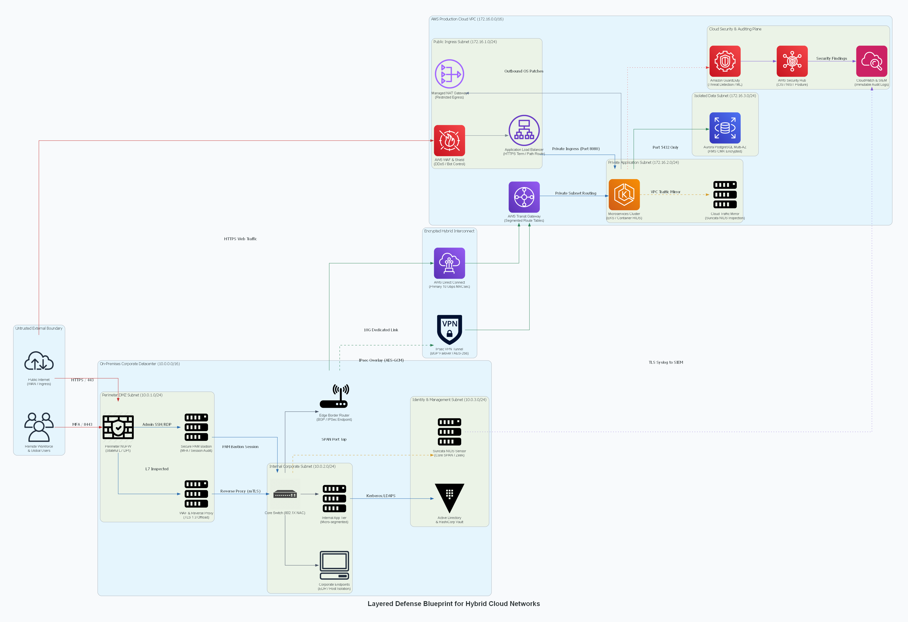

# Layered Defense Blueprint for Hybrid Cloud Networks

[](LICENSE)
[](https://www.python.org/)
[-red.svg)](https://csrc.nist.gov/publications/detail/sp/800-207/final)
[](https://www.pcisecuritystandards.org/)

An enterprise-grade cybersecurity architecture blueprint and infrastructure-as-code automation framework designed to secure hybrid enterprise networks. This repository delivers a programmatic network topology generator, comprehensive stateful firewall filtering matrices, hybrid IDS/IPS deployment models, advanced malware defense frameworks, and an academic-grade architectural PDF report.

---

## Architecture Topology Overview

The hybrid network bridges an **On-Premises Corporate Enterprise Datacenter** (`10.0.0.0/16`) with an **AWS Production Cloud VPC** (`172.16.0.0/16`) via a redundant, cryptographically hardened transport interconnect.



```
+-----------------------------------------------------------------------------------------------------------------------+
|                                           HYBRID ZERO-TRUST SECURITY ARCHITECTURE                                     |
+-----------------------------------------------------------------------------------------------------------------------+
|  UNTRUSTED WAN / INGRESS                                                                                              |
|    * Public Internet & Global Users (HTTPS / Port 443 & Admin MFA / Port 8443)                                        |
+-----------------------------------------------------------+-----------------------------------------------------------+
|  ON-PREMISES ENTERPRISE DATACENTER (10.0.0.0/16)          |  AWS PRODUCTION CLOUD VPC (172.16.0.0/16)                 |
|                                                           |                                                           |
|  [Zone 1: Perimeter DMZ Subnet - 10.0.1.0/24]             |  [Zone 4: Public Ingress Subnet - 172.16.1.0/24]          |
|    - Dual HA Perimeter NGFWs (Stateful L7 DPI)            |    - AWS WAF (Core Rules, SQLi, Bot Control) & Shield     |
|    - Reverse Proxy / WAF (TLS 1.3 Offload)                |    - Dual-AZ Application Load Balancer (HTTPS Term)       |
|    - Secure PAM Bastion (FIDO2 MFA, Session Audit)        |    - Managed NAT Gateways (Restricted OS Patch Egress)    |
|                                                           |                                                           |
|  [Zone 2: Internal Corporate Subnet - 10.0.2.0/24]        |  [Zone 5: Private Application Subnet - 172.16.2.0/24]     |
|    - 802.1X NAC Core Switching                            |    - Amazon EKS Microservices Fleet                       |
|    - Workstations with EDR (Host Isolation Enabled)       |    - DaemonSet Container HIDS                             |
|    - Internal Application Clusters (Micro-segmented)      |    - VPC Traffic Mirror Target (Suricata Inspection)      |
|                                                           |                                                           |
|  [Zone 3: Core Identity & Management - 10.0.3.0/24]       |  [Zone 6: Isolated Data Subnet - 172.16.3.0/24]           |
|    - Active Directory Domain Services & Kerberos KDC      |    - Amazon Aurora PostgreSQL Multi-AZ Cluster            |
|    - HashiCorp Vault (Dynamic Ephemeral Secrets)          |    - KMS Customer-Managed Key (CMK) Encryption at Rest    |
|    - Passive Suricata NIDS Sensor (Core SPAN Port Tap)    |    - Ingress Strictly Whitelisted from EKS (Port 5432)    |
+-----------------------------------------------------------+-----------------------------------------------------------+
|                                     ENCRYPTED HYBRID TRANSPORT BOUNDARY                                               |
|    * Primary: AWS Direct Connect (Dedicated 10 Gbps with IEEE 802.1AE MACsec 256-bit Hardware Encryption)             |
|    * Secondary / Overlay: Route-based IPsec VPN Tunnel (IKEv2, AES-256-GCM, SHA-384, DH Group 21)                    |
|    * BGP Dynamic Routing (AS 65000 / AS 64512) for Automated Sub-second Failover                                      |
+-----------------------------------------------------------------------------------------------------------------------+
|                                  SECURITY OPERATIONS & TELEMETRY PLANE                                                |
|    * Amazon GuardDuty (CloudTrail, VPC Flow Logs ML Anomaly Detection)                                                |
|    * AWS Security Hub (CIS AWS Foundations Benchmark & NIST SP 800-53 Posture Scoring)                                |
|    * Centralized Immutable SIEM/SOAR (Splunk / Elasticsearch) receiving real-time CEF/OCSF Telemetry via TLS          |
+-----------------------------------------------------------------------------------------------------------------------+
```

---

## Layered Defense Strategy (Defense-in-Depth)

The blueprint enforces a multi-tiered security model following **NIST SP 800-53 Rev 5** and **Zero Trust Architecture (NIST SP 800-207)**:

1. **Perimeter Defense & Ingress Filtering:**
   - External ingress terminates at hardened Layer 7 boundary proxies (WAF/Reverse Proxy).
   - Raw administrative protocols (SSH, RDP, Telnet) are dropped at boundary firewalls; remote admin access requires FIDO2 hardware MFA and session recording via an isolated PAM Bastion.
   - Outbound egress is strictly mediated via managed NAT Gateways and forward proxies with FQDN whitelisting.

2. **Micro-Segmentation & Zero Trust Isolation:**
   - Network boundaries enforce stateful default-deny access controls.
   - Inter-workstation communication (East-West traffic on LAN) is suppressed via Private VLANs and 802.1X NAC to prevent peer-to-peer worm propagation.
   - Application containers operate in isolated Kubernetes namespaces governed by strict Cilium NetworkPolicies.

3. **Cryptographic Interconnect Protection:**
   - On-premises and cloud datacenters are unified via a dedicated AWS Direct Connect link protected with Layer 2 IEEE 802.1AE (MACsec) 256-bit encryption.
   - An overlay IPsec tunnel (AES-256-GCM) ensures cryptographic integrity against fiber-tapping, ISP eavesdropping, and BGP route hijacking.

4. **Hybrid IDS/IPS Sensor Architecture:**
   - **Inline NIPS:** Deployed behind DMZ firewalls to actively block exploit payloads (buffer overflows, RCE, directory traversals).
   - **Passive NIDS:** Deployed on internal core switch SPAN ports and AWS VPC Traffic Mirroring sessions to detect lateral movement without adding latency.
   - **Host-Based EDR/HIDS:** CrowdStrike Falcon and OSSEC agents running across all physical endpoints, EC2 instances, and container hosts, resolving the "TLS blind spot" through OS kernel-level process and memory monitoring.

5. **Advanced Malware Defense:**
   - **Endpoint Detection & Response (EDR):** Heuristic machine-learning behavioral analysis, AMSI script deobfuscation, and automated host network isolation upon detection of ransomware activity.
   - **Secure Email Gateway (SEG) & CDR:** Enforcement of SPF, DKIM, and strict DMARC (`p=reject`), paired with Content Disarm and Reconstruction (CDR) stripping executable macros and active scripts from documents.
   - **Zero-Day Sandboxing:** Multi-OS automated hypervisor detonation chambers executing untrusted files, extracting dynamic IOCs, and pushing automated blocking rules globally via STIX/TAXII.

---

## Stateful Firewall Rules Matrix

The following table delineates stateful packet inspection and Layer 7 Application-ID filtering rules enforced across all network boundaries:

| Rule ID | Boundary | Source | Destination | Protocol / Port | Inspection Level | Action | Security Justification |
| :--- | :--- | :--- | :--- | :--- | :--- | :---: | :--- |
| **FW-RULE-01** | WAN &rarr; On-Prem DMZ | `Internet (0.0.0.0/0)` | DMZ WAF / Proxy (`10.0.1.10`) | TCP / 443 | L7 DPI / TLS Offload / WAF | `ALLOW` | Public web service ingress; terminates TLS and filters OWASP Top 10 vulnerabilities. |
| **FW-RULE-02** | WAN &rarr; On-Prem DMZ | Admin IPs / WAN (`0.0.0.0/0`) | PAM Bastion (`10.0.1.20`) | TCP / 8443 | L7 Stateful / FIDO2 MFA / Session Audit | `ALLOW` | Secure administrator jump-host access; raw SSH (22) and RDP (3389) dropped at perimeter. |
| **FW-RULE-03** | DMZ &rarr; Internal LAN | DMZ WAF / Proxy (`10.0.1.10`) | Internal App Tier (`10.0.2.50/28`) | TCP / 8443 | L7 App-ID / Mutual TLS (mTLS) | `ALLOW` | Sanitized reverse proxy request forwarding; prevents direct external access to internal LAN. |
| **FW-RULE-04** | Internal LAN &rarr; Hybrid TGW | Internal Apps (`10.0.2.0/24`) | Cloud Private App (`172.16.2.0/24`) | TCP / 8080, 8443, 9092 | L4 Stateful + L7 App-ID over IPsec | `ALLOW` | Cross-premises microservice API calls and Apache Kafka event streaming over Direct Connect. |
| **FW-RULE-05** | Internal / Cloud &rarr; Identity | Internal & Cloud Apps | AD & Vault (`10.0.3.10-15`) | TCP / 636, 88, 8200 | Stateful Inspection / LDAP Signing | `ALLOW` | Centralized identity validation (LDAPS/Kerberos) and ephemeral secrets retrieval via Vault. |
| **FW-RULE-06** | WAN &rarr; Cloud Public Subnet | `Internet (0.0.0.0/0)` | AWS Cloud ALB (`172.16.1.100`) | TCP / 443 | AWS WAF Managed Rules / Shield DDoS | `ALLOW` | Cloud web ingress gateway; rate-limiting and bot mitigation enabled; HTTP redirected to HTTPS. |
| **FW-RULE-07** | Cloud Public &rarr; Cloud Private | Cloud ALB (`sg-alb-ingress`) | EKS Microservices (`172.16.2.0/24`) | TCP / 8080 | Security Group Reference / L4 Stateful | `ALLOW` | Decoupled traffic distribution to container workloads; instances have no public IPs. |
| **FW-RULE-08** | Cloud Private &rarr; Cloud Database | EKS Microservices (`sg-app`) | Aurora PostgreSQL (`172.16.3.50`) | TCP / 5432 | L4 Stateful / Enforce TLS / IAM Auth | `ALLOW` | Application data persistence; isolated DB subnet denies all traffic except authorized app tier. |
| **FW-RULE-09** | Private Tiers &rarr; External WAN | Internal LAN & Cloud Private | External Repositories (Whitelisted) | TCP / 443 | NAT Gateway / Forward Proxy FQDN Filter | `ALLOW` | Outbound security patches (apt/yum) and container registry pulls; unrestricted egress blocked. |
| **FW-RULE-10** | All Hybrid Boundaries | `ANY (*)` | `ANY (*)` | `ALL (*)` | Stateful Packet Drop / SIEM Alerting | `DENY` | Zero Trust baseline: implicit deny rule dropping all unregistered traffic and logging attempts. |

---

## Cybersecurity Risk Assessment Matrix

Conducted in accordance with **NIST SP 800-30 Revision 1**:

| Threat ID | Identified Threat Vector | Likelihood | Impact | Blueprint Mitigation Strategy | Residual Risk |
| :---: | :--- | :---: | :---: | :--- | :---: |
| **THR-01** | Ransomware Lateral Movement via Interconnect | **High** | **Critical** | Stateful boundary firewalls block SMB (445), RPC (135), and RDP (3389) over Direct Connect/VPN. Micro-segmentation on LAN, EDR canary traps, automated host quarantine, and WORM-locked cloud backups. | **Low** |
| **THR-02** | Zero-Day Remote Code Execution (RCE) on DMZ | **Medium** | **Critical** | Dual WAF inspection (AWS WAF & On-Prem ModSecurity) with virtual patching. Read-only container root filesystems, non-root execution, and Suricata NIPS blocking egress reverse shells. | **Low** |
| **THR-03** | Insider Threat & Credential Harvesting | **Medium** | **High** | 802.1X NAC endpoint posture enforcement. Internal NIDS monitoring for Pass-the-Hash, Golden Ticket, and Kerberoasting. Dynamic ephemeral credentials via Vault and mandatory hardware FIDO2 MFA. | **Low** |
| **THR-04** | Man-in-the-Middle (MitM) & BGP Route Hijack | **Low** | **High** | IEEE 802.1AE MACsec (256-bit) point-to-point encryption on Direct Connect. IPsec VPN overlay with IKEv2, AES-256-GCM, and Diffie-Hellman Group 21. BGP MD5 authentication and RPKI filtering. | **Low** |
| **THR-05** | Cloud Data Exfiltration via Compromised Container | **Medium** | **Critical** | Strict IAM Roles for Service Accounts (IRSA) with least-privilege scoping. Database residing in isolated private subnet with zero internet route. Egress proxy FQDN whitelisting and GuardDuty ML anomaly alerts. | **Low** |

---

## Installation & Usage

### Prerequisites
1. **Python 3.10+**
2. **Graphviz** (Required by the `diagrams` library):
   - **Windows:** Installed automatically or available at `C:\Program Files (x86)\Graphviz\bin` or via `winget install Graphviz.Graphviz`.
   - **macOS:** `brew install graphviz`
   - **Linux:** `sudo apt-get install -y graphviz`

### Setup
Clone the repository and install the dependencies:
```bash
git clone https://github.com/kevinmonteiro543-sketch/-Layered-Defense-Blueprint-for-Hybrid-Cloud-Networks.git
cd -Layered-Defense-Blueprint-for-Hybrid-Cloud-Networks
pip install -r requirements.txt
```

### Execution

#### 1. Generate Network Topology & View CLI Security Tables
Run `generate_blueprint.py` to print the formatted Firewall Rules and Risk Assessment matrices in your terminal, and programmatically render `hybrid_topology.png`:
```bash
python generate_blueprint.py
```

Options:
- `--no-diagram`: Display terminal security tables without regenerating the PNG diagram.
- `--pdf`: Print terminal tables, generate `hybrid_topology.png`, and automatically compile the comprehensive PDF blueprint.

#### 2. Generate Publication-Grade Academic PDF Report
Compile the formal 11-page architectural specification PDF:
```bash
python generate_pdf_report.py
```
This generates `Hybrid_Cloud_Defense_Blueprint.pdf` with:
- Academic running headers, footers, and page numbers ("Page X of Y").
- Embedded high-resolution topology diagram.
- Formatted tables with text wrapping and alternating row highlights.
- In-depth theoretical treatises on NIDS vs HIDS, malware containment pipelines, and zero-trust boundary controls.
- Full source code appendix.

---

## Repository Structure

```
.
├── generate_blueprint.py             # Core Python script generating topology diagram & CLI matrices
├── generate_pdf_report.py            # PDF compiler generating academic specification report
├── hybrid_topology.png               # Programmatically generated high-resolution architecture diagram
├── Hybrid_Cloud_Defense_Blueprint.pdf # Publication-quality 11-page defense blueprint report
├── requirements.txt                  # Python dependencies
├── push_to_github.py                 # Automated git deployment script using subprocess
└── README.md                         # Comprehensive architecture documentation
```

---

## Security Compliance & References
- **NIST SP 800-207:** Zero Trust Architecture
- **NIST SP 800-53 Rev 5:** Security and Privacy Controls for Information Systems and Organizations
- **NIST SP 800-30 Rev 1:** Guide for Conducting Risk Assessments
- **PCI-DSS v4.0:** Payment Card Industry Data Security Standard
- **CIS AWS Foundations Benchmark v1.4.0**
- **MITRE ATT&CK Framework for Enterprise**

---

## Author & Attribution
Developed by Autonomous Cybersecurity Architecture Agent for Enterprise Hybrid Cloud Infrastructure Protection.
Repository: [kevinmonteiro543-sketch/-Layered-Defense-Blueprint-for-Hybrid-Cloud-Networks](https://github.com/kevinmonteiro543-sketch/-Layered-Defense-Blueprint-for-Hybrid-Cloud-Networks.git)
